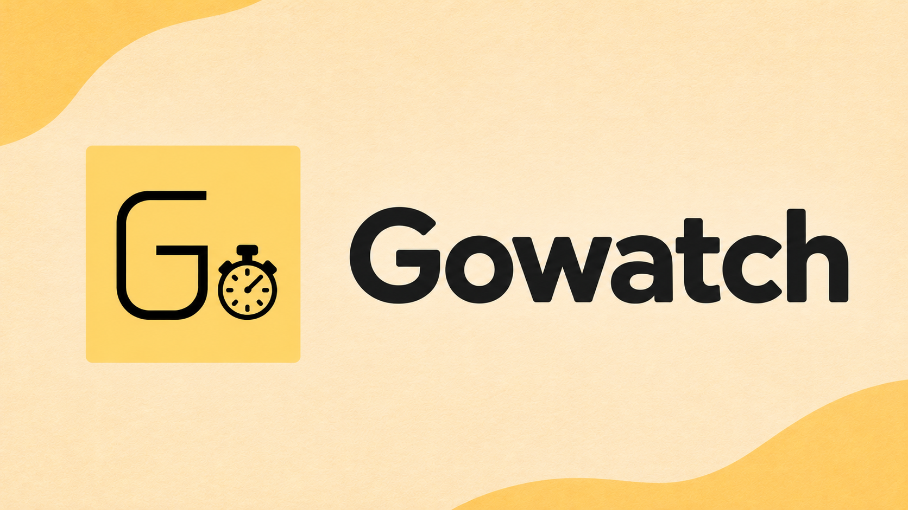

# Gowatch

### 🤖 명령어
- ``/집중 기록 [타이머]`` : 해당 내용에 대한 집중모드를 시작(기본 : 1시간)
  - ``타이머``는 h, m, s 단위로 시간 단위를 설정할 수 있음(단위 기본 : m)
- ``/집중 정지`` : 진행 중인 집중모드를 정지 시킬 수 있음
- ``/집중 중지`` : 진행 중인 집중모드를 중지 시킬 수 있음
- ``/집중 재개`` : 중지된 집중모드를 진행 시킬 수 있음
- ``/목록`` : 현재 집중모드를 사용하는 유저 목록 확인할 수 있음
- ``/리더보드 (음성/집중)`` : 음성채팅 또는 집중모드를 오래 사용한 상위 10명의 유저를 보여줍니다.